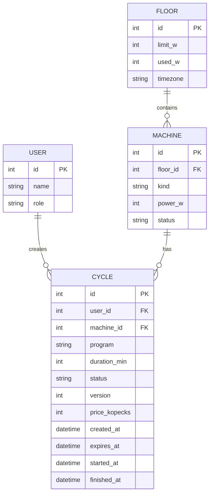
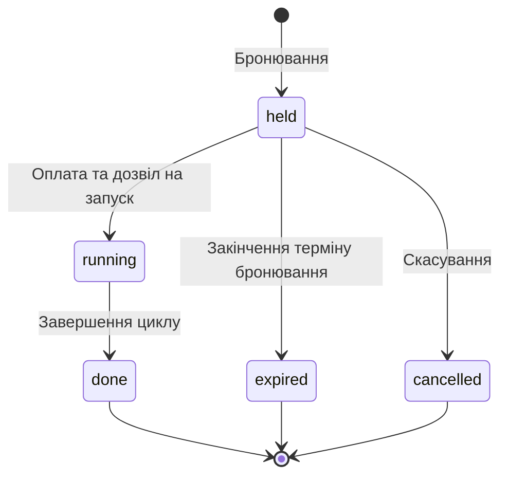
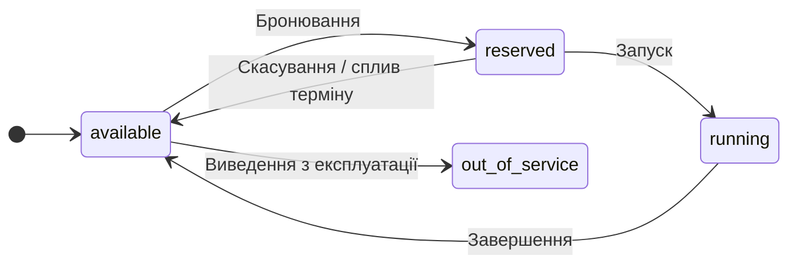

# О1.1. Модель предметної області

## 1. Загальна інформація

- Тема: C27 - «Пральня гуртожитку».
- Дисципліна: «Обмін даними у Web-застосунках».

## 2. Опис предметної області

Система призначена для бронювання та використання пральних
і сушильних машин у гуртожитку.

Студенти можуть переглядати доступні машини, бронювати їх,
вибирати програму, оплачувати, запускати та переглядати
власні цикли.

Комендант контролює стан обладнання та може виводити
машини з експлуатації.

Спільними ресурсами системи є:

- пральні та сушильні машини;
- доступна електрична потужність поверху.

Основна складність системи - одночасні запити багатьох
студентів у періоди пікового навантаження, зокрема
в неділю ввечері.

## 3. Ролі користувачів

| Роль | Ідентифікатор | Можливості |
|---|---|---|
| Студент | `student` | Перегляд машин, бронювання, вибір програми, оплата, запуск і скасування власних циклів |
| Комендант | `commandant` | Перегляд стану обладнання та виведення машин з експлуатації |

## 4. Сутності предметної області

### 4.1. User - користувач

Представляє користувача системи.

| Атрибут | Опис |
|---|---|
| `id` | Унікальний ідентифікатор користувача |
| `name` | Ім'я користувача |
| `role` | Роль: `student` або `commandant` |

### 4.2. Floor - поверх гуртожитку

Представляє поверх гуртожитку, на якому розташовані машини
та встановлено обмеження електричної потужності.

| Атрибут | Опис |
|---|---|
| `id` | Унікальний ідентифікатор поверху |
| `limit_w` | Максимальна дозволена потужність у ватах |
| `used_w` | Поточна потужність, виділена DPC для запущених або дозволених до запуску циклів, у ватах. |
| `timezone` | Назва часової зони гуртожитку |

### 4.3. Machine - пральна або сушильна машина

Представляє обладнання, доступне для бронювання
та виконання циклів.

| Атрибут | Опис |
|---|---|
| `id` | Унікальний ідентифікатор машини |
| `floor_id` | Ідентифікатор поверху |
| `kind` | Тип машини: `washer` або `dryer` |
| `power_w` | Номінальна потужність машини у ватах |
| `status` | Поточний стан машини |

### 4.4. Cycle - цикл використання машини

Представляє бронювання та подальше використання машини
конкретним студентом.

| Атрибут | Опис |
|---|---|
| `id` | Унікальний ідентифікатор циклу |
| `user_id` | Ідентифікатор студента |
| `machine_id` | Ідентифікатор машини |
| `program` | Обрана програма прання або сушіння |
| `duration_min` | Тривалість циклу у хвилинах |
| `status` | Поточний стан циклу |
| `version` | Версія запису для контролю конкурентних змін |
| `price_kopecks` | Вартість циклу в копійках (UAH) |
| `created_at` | Час створення бронювання |
| `expires_at` | Час завершення терміну бронювання |
| `started_at` | Фактичний час запуску циклу |
| `finished_at` | Фактичний час завершення циклу |

## 5. Зв'язки між сутностями

- Один поверх містить багато машин.
- Кожна машина належить одному поверху.
- Одна машина може мати багато циклів протягом часу.
- Кожен цикл належить одній машині та одному студенту.
- Один студент може створювати багато циклів.

### ER-діаграма



## 6. Стани циклу

| Стан | Опис |
|---|---|
| `held` | Машину заброньовано, очікується запуск |
| `running` | Цикл виконується |
| `done` | Цикл завершено |
| `expired` | Термін бронювання закінчився |
| `cancelled` | Бронювання скасовано |

### 6.1. Дозволені переходи циклу



Стани `done`, `expired` та `cancelled` є кінцевими.

Зміна програми можлива у стані `held` з перевіркою
поточної версії запису.


## 7. Стани машини

Для реалізації системи визначено такі стани машини:

| Стан | Опис |
|---|---|
| `available` | Машина доступна |
| `reserved` | Машину заброньовано |
| `running` | Машина виконує цикл |
| `out_of_service` | Машина виведена з експлуатації |

### 7.1. Дозволені переходи машини

Комендант може вивести з експлуатації лише машину у стані `available`.



## 8. Інваріанти

Інваріанти - це правила, які повинні виконуватися
незалежно від кількості одночасних запитів користувачів.

### 8.1. Єдиний активний цикл

Одна машина не може одночасно мати більше одного циклу
у стані `held` або `running`.

Кількість активних циклів для кожної машини:

```text
active_cycles(machine_id) <= 1
```

### 8.2. Обмеження потужності поверху

Сумарна потужність увімкнених машин не може перевищувати
встановлений ліміт потужності поверху.

```text
0 <= used_w <= limit_w
```

Перед запуском циклу необхідно перевірити:

```text
used_w + requested_power_w <= limit_w
```

Якщо доступної потужності недостатньо, запуск відхиляється.

DPC відповідає за атомарну перевірку та виділення
потужності поверху.

Якщо запуск не відбувся, виділена потужність повинна
бути звільнена без повторного зменшення лічильника.

### 8.3. Термін бронювання

Бронювання дійсне протягом 10 хвилин.

```text
expires_at = created_at + 10 хвилин
```

Запуск дозволено лише за умови:

```text
current_time < expires_at
```

### 8.4. Часове обмеження

Цикл не можна запустити, якщо він завершиться
після 23:00 за місцевим часом гуртожитку.

```text
planned_finish = start_time + duration_min
planned_finish <= 23:00
```

Часові мітки зберігаються в UTC, а часове обмеження
перевіряється в часовій зоні гуртожитку.

### 8.5. Доступність обладнання

Машина у стані `out_of_service` не може бути
заброньована або запущена.

### 8.6. Коректність даних

Мають виконуватися такі умови:

```text
limit_w > 0
power_w > 0
duration_min > 0
price_kopecks > 0
version >= 1
```

### 8.7. Ідемпотентність операцій

Повторний запит не повинен спричиняти:

- створення дубліката бронювання;
- повторну оплату циклу;
- повторний запуск машини;
- повторне звільнення потужності.

Повтор запиту з тим самим ключем ідемпотентності
повертає збережений результат відповідної операції.

### 8.8. Контроль доступу

- Студент може переглядати та змінювати лише власні цикли.
- Виведення машини з експлуатації доступне лише
  користувачу з роллю `commandant`.

## 9. Числові параметри

### 9.1. Параметри

| Параметр | Значення |
|---|---|
| Термін бронювання | 10 хвилин |
| Граничний час завершення циклу | 23:00 |
| Одиниця вимірювання потужності | Ват |
| Одиниця вимірювання тривалості | Хвилина |
| Одиниця вимірювання вартості | Копійка |
| Співвідношення грошових одиниць | 1 грн = 100 коп. |
| Час відповіді зовнішнього симулятора Web | 2-5 секунд |
| Імовірність відхилення оплати | 10 % |

### 9.2. Параметри контрольного сценарію

| Параметр | Значення |
|---|---|
| Кількість машин на поверсі | 10 |
| Ліміт потужності поверху | 10 000 Вт |
| Потужність однієї машини | 2 000 Вт |
| Максимальна кількість одночасно запущених машин | 5 |

### 9.3. Навчальні припущення

Для початкової реалізації використовуються такі
параметри програм:

| Програма | Потужність | Тривалість | Вартість |
|---|---:|---:|---:|
| Стандартне прання | 2 000 Вт | 60 хв | 5 000 коп. |
| Стандартне сушіння | 2 000 Вт | 45 хв | 4 000 коп. |